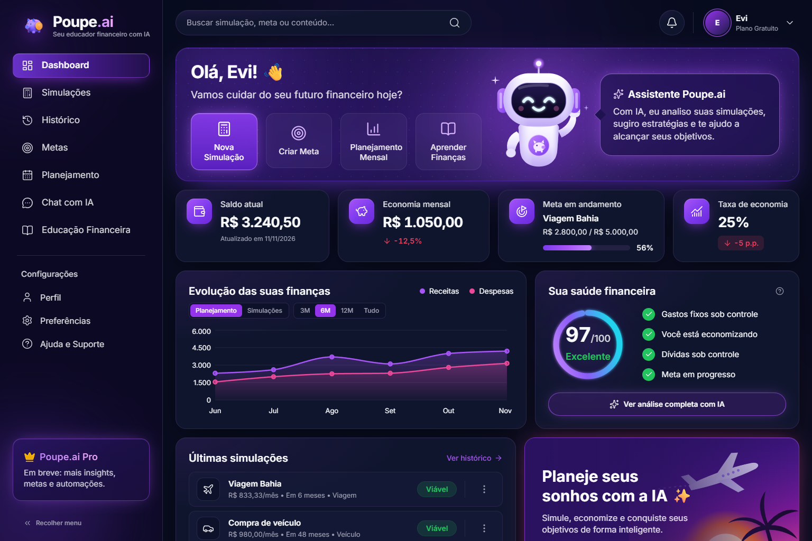
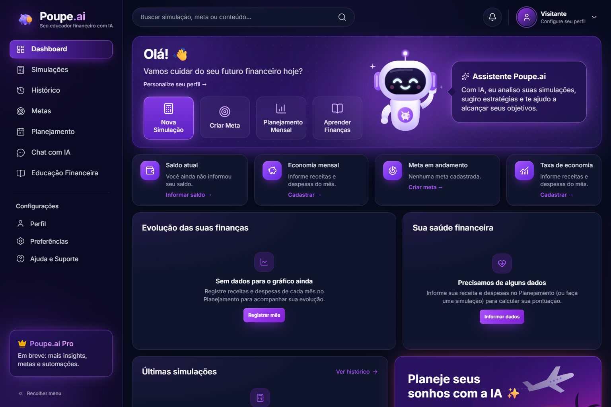
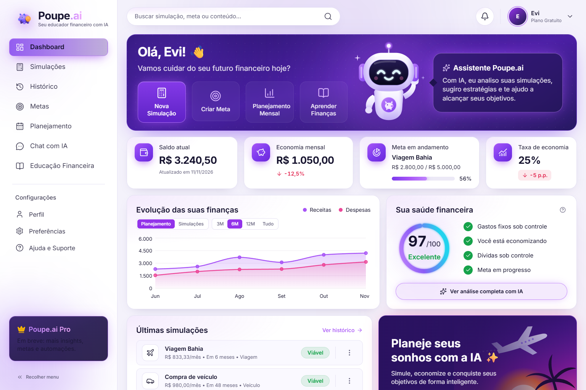
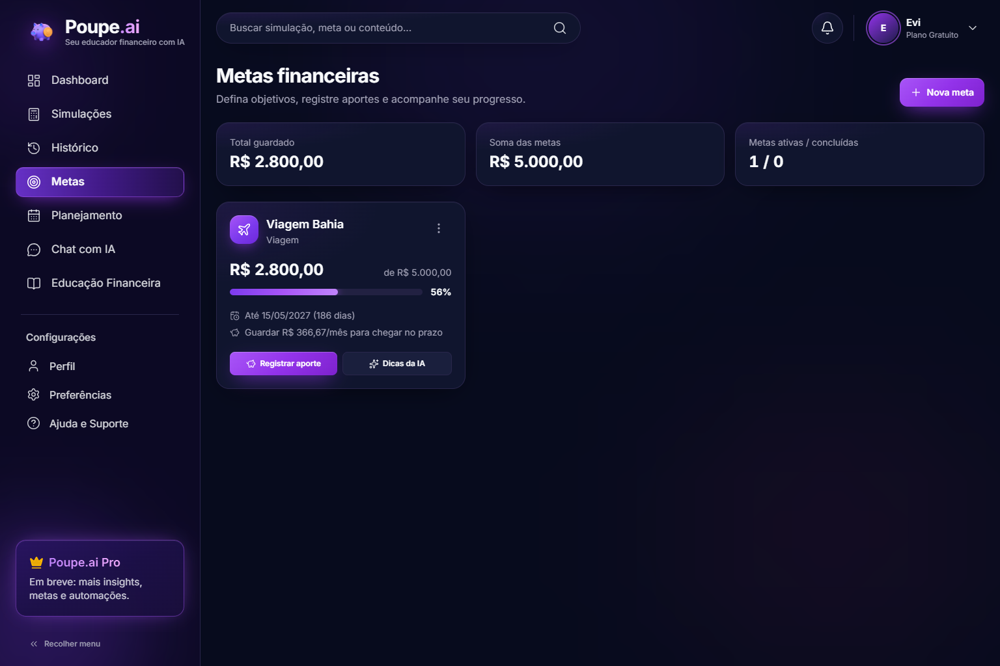
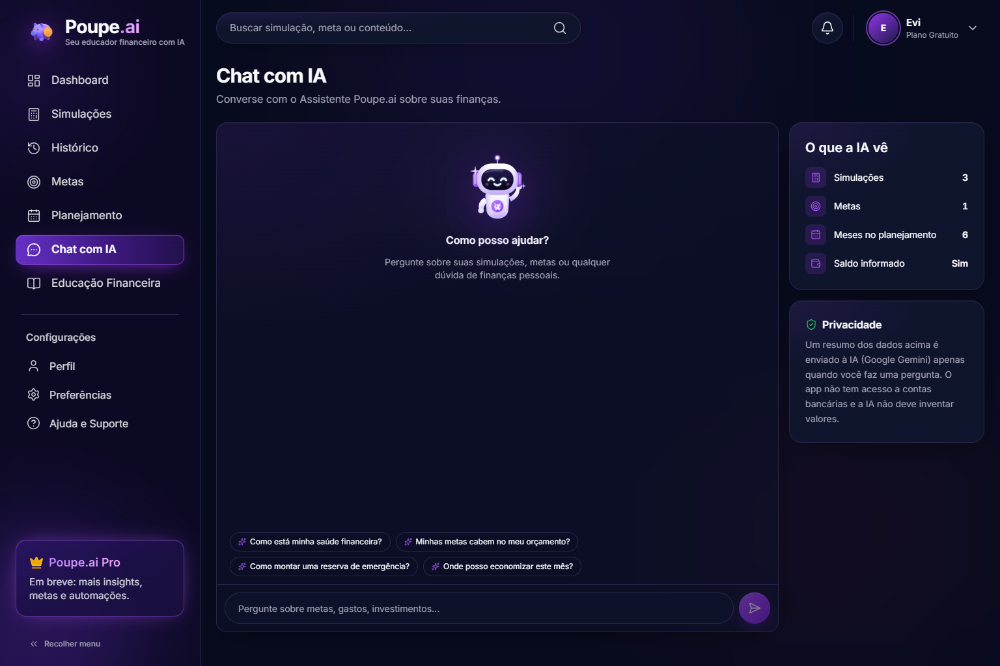

### ⬢ **Desenvolvendo um Educador Financeiro com React e IA Generativa**


*Este projeto foi desenvolvido durante o Bootcamp Santander na DIO (Digital Innovation One), como parte de uma iniciativa prática voltada à criação de aplicações modernas com React e TypeScript.*

*A proposta do bootcamp foi simular desafios reais do mercado, incentivando o desenvolvimento de uma aplicação completa com foco em educação financeira, interface moderna e uso de Inteligência Artificial.*

---


⬡ Acesso ao Projeto

 [](https://poupe-9lu178psa-eliane-vitoriano-luiz-s-projects.vercel.app)


---

⬡ *Tecnologias e Ferramentas*


---

⬡ *Propósito*

- Criar uma plataforma de educação financeira moderna e interativa
- Aplicar Inteligência Artificial para suporte ao usuário
- Desenvolver simulações financeiras com lógica realista
- Armazenar histórico de consultas e decisões do usuário
- Melhorar a experiência com interface dinâmica e responsiva
- Explorar integração entre frontend e IA generativa
- Praticar desenvolvimento frontend moderno com React
- Trabalhar componentização e organização de código
- Aplicar lógica de cálculos financeiros na prática
- Criar interface responsiva e intuitiva
- Desenvolver sistema de histórico com persistência local

---

⬡ *Demonstração do Sistema — Poupe.ai 2.0*

<p>
  
</p>
<p>
  
  
</p>
<p>
  
  
</p>

> As capturas usam dados de exemplo inseridos apenas no navegador de teste.

---


⬡ *Funcionalidades do Projeto*

- **Dashboard** com saldo, economia mensal, meta em andamento, taxa de economia, gráfico de receitas x despesas e pontuação de saúde financeira — tudo calculado a partir dos dados que você informa (sem valores inventados; estados vazios quando falta informação)
- **Simulações financeiras** em etapas, com diagnóstico gerado por IA, edição e exclusão com confirmação
- **Histórico** com busca e filtro por viabilidade
- **Metas** com aportes/retiradas, progresso, prazo e recomendações da IA (é possível transformar uma simulação em meta)
- **Planejamento mensal**: saldo atual e receitas/despesas de cada mês
- **Chat com IA** que conhece suas simulações, metas e planejamento — e é instruído a não inventar dados nem afirmar acesso a bancos
- **Educação financeira** com conteúdos curtos e atalho para perguntar à IA
- **Busca global** (Ctrl/⌘ + K), **notificações** derivadas dos seus dados e **perfil local** editável
- Tema escuro/claro, menu lateral recolhível, layout responsivo e navegação por teclado
- Exportação e limpeza dos dados em Preferências
- Chave do Gemini protegida no servidor (`/api/gemini`), fora do bundle do navegador

---


⬡ *Estrutura do Projeto*

```
📦 api/gemini.ts          → função serverless (Vercel) que chama o Gemini
📦 server/gemini.ts       → lógica do proxy, compartilhada com o Vite em dev
📦 src
┣ 📂 components
┃ ┣ 📂 layout              → DashboardLayout, Sidebar, Topbar, busca, notificações
┃ ┣ 📂 features            → Dashboard, Simulation, Goals, Chat, Insights…
┃ ┗ 📂 ui                  → Modal, botões, cards, menus, estados vazios
┣ 📂 data                  → tipos, prompts da IA, conteúdos educativos, navegação
┣ 📂 hooks                 → useSimulationStorage, useInsight, useFinancialOverview
┣ 📂 lib                   → store reativo sobre o localStorage
┣ 📂 stores                → metas, planejamento, perfil, preferências, chat
┣ 📂 pages                 → uma página por rota
┣ 📂 services              → cliente da IA
┗ 📂 utils                 → cálculos financeiros, saúde financeira, formatação
```

---

⬡ Como Executar

```bash
git clone https://github.com/EVI-DEV1/POUPE.AI.git
cd POUPE.AI
npm install
cp .env.example .env   # informe GEMINI_API_KEY
npm run dev
```

A IA é chamada pela rota `/api/gemini`: em desenvolvimento ela roda dentro do próprio Vite; na Vercel, em `api/gemini.ts`. Na Vercel, configure a variável de ambiente **GEMINI_API_KEY** (por compatibilidade, `VITE_GEMINI_API_KEY` ainda é aceita, mas só no servidor). Sem a chave, o app funciona normalmente e mostra um aviso amigável nas funções de IA.

⬡ Scripts Disponíveis

⬡ npm run dev → ambiente de desenvolvimento

⬡ npm run build → verificação de tipos + build de produção

⬡ npm run preview → visualização local do build (inclui a rota /api/gemini)

⬡ npm run lint → análise de código

---


⬡ *Aprendizados* 

Este projeto contribuiu para o desenvolvimento de habilidades como:

* Estruturação de aplicações React
  
* Componentização e reutilização de código
  
* Gerenciamento de estado local
  
* Manipulação de dados e lógica de negócio
  
* Persistência com LocalStorage
  
* Boas práticas de organização de projeto
 
* Gerenciamento de estado em aplicações React
  
* Persistência de dados no frontend 

* Criação de interfaces dinâmicas e responsivas

* Organização de arquitetura de projeto

* UX com foco em fluidez e acessibilidade
  
* Implementação de temas (dark/light mode)  

---

⬡ *Melhorias Futuras*

- Integração com backend real

- Sistema de autenticação de usuários

- Exportação de relatórios em PDF

- Deploy em ambiente de produção

---

⬡ *Autoria*

Desenvolvido por ***EVI-DEV1*** © 2026

---

⬢ **“Cada componente construído é um passo a mais para dominar o frontend moderno.”** ⬢


